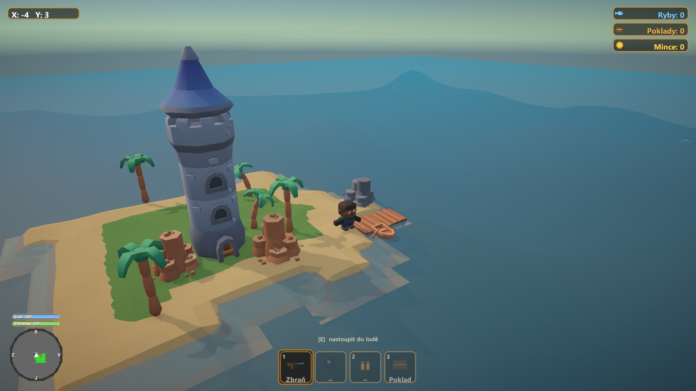
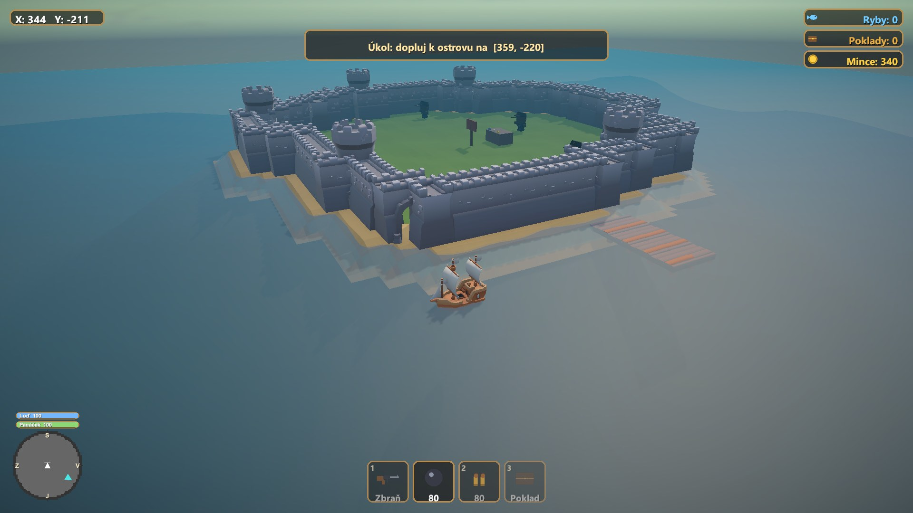
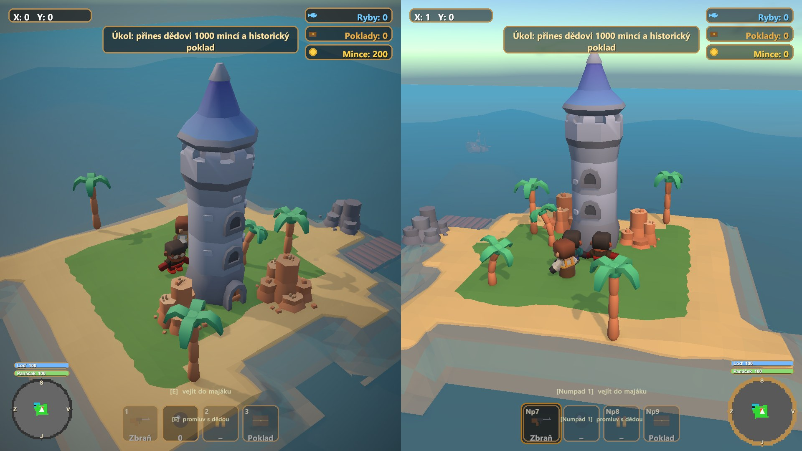

# 🌊 The Last Beacon

Maturitní projekt — 3D hra v Unity. Hráč pluje po nekonečně generovaném
oceánu, rybaří, těží poklady z vraků, bojuje s piráty a nepřátelskými
ostrovy, vylepšuje si loď v majáku a postupně odemyká příběh o rodinném
dědictví a ztraceném bratrovi. Podporuje lokální split-screen pro dva hráče.



| Pirátská pevnost | Split-screen pro dva hráče |
|---|---|
|  |  |

**Stav:** MVP hotové — hru lze dohrát od nové hry po oba konce příběhu, ukládá
se a načítá a běží z buildu. Do dubna 2027 zbývá dokumentace, testovací
protokol a release.

## Obsah

- [Co ve hře je](#co-ve-hře-je)
- [Jak spustit](#jak-spustit)
- [Ovládání](#ovládání)
- [Technologie](#technologie)
- [Struktura projektu](#struktura-projektu)
- [Dokumentace](#dokumentace)
- [Příběh](#příběh)
- [Použité assety a licence](#použité-assety-a-licence)

## Co ve hře je

- **Nekonečný svět** — dlaždice se generují líně kolem hráče, ostrovy vznikají
  organicky s molem, majákem a náhodnou dekorací.
- **Ekonomika** — rybaření a těžba pokladů z vraků, prodej ve výkupně,
  questy a mega questy, upgrady lodi (veslice → malá → střední → velká).
- **Souboj** — piráti na moři (tři velikosti lodí), nepřátelské ostrovy s
  děly, dělo na vlastní lodi, boss health bar.
- **Maják** — vnitřní scéna se třemi pulty (výkupna, obchod s vylepšeními,
  obchod s questy), kulatá minimapa se světovými stranami.
- **Lokální multiplayer** — split-screen pro dva hráče, oddělené ekonomiky,
  možnost převodu mincí mezi hráči.
- **Vývojářská konzole** — cheaty pro rychlé testování (peníze, teleport,
  odemčení upgradů, příkazy pro příběh).
- **Příběhová linka** — tři "mega ostrovy" s vlastní obranou, hádankou a
  postavami, viz [Příběh](#příběh) níže.

## Jak spustit

1. Otevři projekt v **Unity Hubu** (verze **6000.3.10f1**).
2. Otevři scénu `Assets/Scenes/SampleScene.unity`.
3. Stiskni **Play**.

Windows build se dělá přes *File → Build Profiles* (obě scény jsou v Build Settings); CI zatím není.

## Ovládání

| Akce | Hráč 1 | Hráč 2 |
|---|---|---|
| Pohyb | `W A S D` | šipky |
| Nastoupit/vystoupit z lodě, vejít do budovy | `E` | `Numpad 1` |
| Rybařit / těžit / kopat | `Mezerník` | `Numpad 0` |
| Střelba z děla | levé tlačítko myši | `Numpad *` |
| Oprava lodě u mola | `R` | `Numpad /` |
| Velká mapa | `M` | `Numpad 2` |
| Otáčení / přiblížení kamery | pravé tlačítko myši / kolečko | — |
| Pauza | `Esc` | `Numpad Enter` |
| Vývojářská konzole | `` ` `` (obě) | |

## Technologie

- **Unity 6000.3.10f1**, Universal Render Pipeline 17.3.0
- Jazyk C#, bez externích frameworků — vlastní jednoduché systémy pro svět,
  ukládání i UI (IMGUI + runtime uGUI), ať je kód čitelný a obhajitelný.
- Save systém: JSON (`JsonUtility`) do `Application.persistentDataPath`,
  3 nezávislé sloty, odložený zápis na pozadí a migrace starých savů.
- Testy: 26 automatických testů (22 EditMode + 4 PlayMode) — v Unity
  *Window → General → Test Runner*.
- Vývoj přes větve a pull requesty do `main`.

## Struktura projektu

```
Assets/
  Scripts/     — veškerý herní kód (59 skriptů, žádný namespace, české komentáře)
  Tests/       — automatické testy (EditMode, PlayMode)
  Scenes/      — SampleScene (hlavní hra) + LighthouseInterior (maják)
  Resources/   — modely postav/lodí/obludy načítané za běhu
  Materials/, Kenney/, KenneyBoat/, Prefabs/  — assety
docs/          — dokumentace projektu (viz níže) a snímky obrazovky
```

## Dokumentace

Vše je ve složce [`docs/`](docs/):

| Dokument | Soubor |
|---|---|
| Vymezení tématu (úkol 1) | [`Ukol1_Vymezeni_tematu.docx`](docs/Ukol1_Vymezeni_tematu.docx) |
| Project Charter | [`Project_Charter.docx`](docs/Project_Charter.docx) |
| Plán ročníkové práce | [`Plan_rocnikove_prace.docx`](docs/Plan_rocnikove_prace.docx) |
| Ročníková práce | [`Rocnikova_prace_The_Last_Beacon.docx`](docs/Rocnikova_prace_The_Last_Beacon.docx) |
| Uživatelská příručka | [`Uzivatelska_prirucka_The_Last_Beacon.docx`](docs/Uzivatelska_prirucka_The_Last_Beacon.docx) |
| Prezentace (11. 11. 2026) | [`Prezentace_The_Last_Beacon.pptx`](docs/Prezentace_The_Last_Beacon.pptx) |

Dokumenty se generují skripty `docs/mk_*.js` (Node.js) a diagramy
`docs/mk_diagramy.py`.

Podrobný popis architektury (jak spolu skripty mluví, konvence, na co si dát
pozor při úpravách) je v [`CLAUDE.md`](CLAUDE.md) — píše se a udržuje průběžně
jako pracovní dokumentace pro vývoj s pomocí AI asistenta (Claude Code).

## Příběh

Hráč postupně odemyká krátký příběh u dědy na startovním ostrově: rodinné
dědictví, o kterém neví — a dědův dávno ztracený starší bratr, kterého
rodina považovala za mrtvého. Oblouk vede přes tři tematicky odlišné mega
ostrovy (opevněná pevnost, hřbitov lodí, finální konfrontace) a končí
volbou hráče, která rozhoduje o jednom ze dvou konců.

Detailní návrh (postavy, dialogy, technická kostra) je v
[`.claude/story-plan.md`](.claude/story-plan.md).

## Použité assety a licence

Vlastní zdrojový kód je pod licencí **MIT** (viz [`LICENSE`](LICENSE)).
Veškerá grafika třetích stran je **CC0** (public domain), licenční soubory
jsou přiložené vedle modelů v `Assets/Resources/` a evidence je v
[`THIRD_PARTY_LICENSES.md`](THIRD_PARTY_LICENSES.md):

- **Kenney** — Pirate Kit, Mini Characters ([kenney.nl](https://kenney.nl))
- **Quaternius** — Shark (mořská obluda), Ghost Ship (Bludný Holanďan)
  ([quaternius.com](https://quaternius.com))

---

*Maturitní projekt, vytvořeno s pomocí [Claude Code](https://claude.com/claude-code).*
